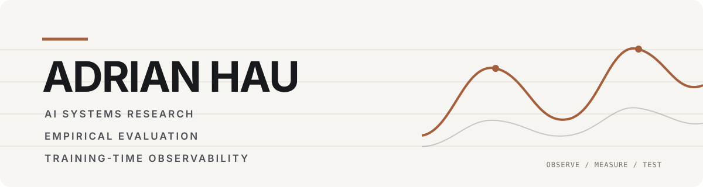

<picture>
  <source media="(prefers-color-scheme: dark)" srcset="./assets/masthead-dark.svg">
  <source media="(prefers-color-scheme: light)" srcset="./assets/masthead-light.svg">
  
</picture>

<p align="center">
  <strong>AI systems researcher · Model evaluator · Technical founder</strong>
</p>
<p align="center"><i>
  Pro uno in tenebris ubi nemo umquam sciet aut videbit.</i>
</p>  

<p align="center">
  Co-founder &amp; CTO at <a href="https://github.com/PYPER3"><strong>PYPER³</strong></a>
  &nbsp;·&nbsp;
  Founder of <a href="https://www.arcafutura.com/"><strong>Arca Futura</strong></a>
</p>


<p align="center">
  <a href="#featured-research">Research</a>
  &nbsp;&nbsp;·&nbsp;&nbsp;
  <a href="#current-focus">Current focus</a>
  &nbsp;&nbsp;·&nbsp;&nbsp;
  <a href="https://www.arcafutura.com/">Contact</a>
</p>


---

> ### How do we test whether an AI claim is actually true?

I build experiments and instrumentation that make the behavior of machine-learning
systems measurable, falsifiable, and operationally useful. My work focuses on
training-time observability, model forensics, and empirical evaluation—particularly
where a compelling claim needs better controls, stronger telemetry, or an
independent attempt to break it.

At **PYPER³**, I lead development and research on **AEGIS**, a training-time
observability and governance system.

## Featured research

|  |  |
|:--|:--|
| **AEGIS**<br><sub>TRAINING-TIME OBSERVABILITY · ACTIVE DEVELOPMENT</sub><br><br>Instrumentation for detecting and characterizing unusual internal dynamics during machine-learning training. The initial Trial SDK is detection-only and designed for shadow-mode evaluation.<br><br>[PYPER³ →](https://github.com/PYPER3) | **Model Forensics: Value Leakage**<br><sub>CONTROLLED EVALUATION · CODE + RESULTS</sub><br><br>A provider-neutral apparatus for testing when value-laden context changes factual estimates—and for separating directional revision from task-framing effects.<br><br>[Inspect the experiment →](https://github.com/Founder-ArcaFutura/model_forensics_values_leakage) |
| **Emergent Depthwise Activation Structure**<br><sub>TRAINING DYNAMICS · PREPRINT + CODE + DATA</sub><br><br>A recurring three-phase depthwise activation pattern studied across transformer families, parameter scales, and training checkpoints—the **Hau Curve** and its early-training attractor pattern.<br><br>[Preprint →](https://zenodo.org/records/21222115) · [Code and data →](https://github.com/Founder-ArcaFutura/emergent_depthwise_activation_structure_in_LLMs_code_data) | **StratEval**<br><sub>STRATEGIC-BEHAVIOR EVALUATION · PUBLIC ARTIFACT</sub><br><br>A scenario-based evaluation suite for strategic misalignment under instrumental pressure, with a public taxonomy, prompt templates, analysis code, and sanitized scenario sample.<br><br>[Repository →](https://github.com/Founder-ArcaFutura/StratEval) · [Preprint →](https://zenodo.org/records/20419741) |

## Current focus

```text
OBSERVE  →  MEASURE  →  CHALLENGE  →  REPLICATE  →  GOVERN
```

- **Training reliability:** anomaly detection, optimizer-state dynamics, and
  distributed-training observability.
- **Model forensics:** controlled tests of how contextual pressures alter model
  judgments and explanations.
- **Mechanistic measurement:** recurring internal structure and developmental
  dynamics in transformer models.
- **Adversarial evaluation:** falsifiable benchmarks, controls, ablations, and
  failure-mode discovery.

## Working principles

| Evidence before narrative | Controls before conclusions | Artifacts before assurances |
|:--|:--|:--|
| Claims should be inspectable. | “Different” is not implicitly “better.” | Prompts, manifests, outputs, and analysis belong together. |

## Collaboration

I am interested in technically serious collaborations involving model evaluation,
training reliability, mechanistic or behavioral measurement, research engineering,
and independent validation of AI systems.

If you are working on one of these problems and think there may be overlap,
[get in touch](https://www.arcafutura.com/).

---

<p align="center">
  <sub>Empirical AI systems research · Inspectable claims · Reproducible artifacts</sub>
</p>
